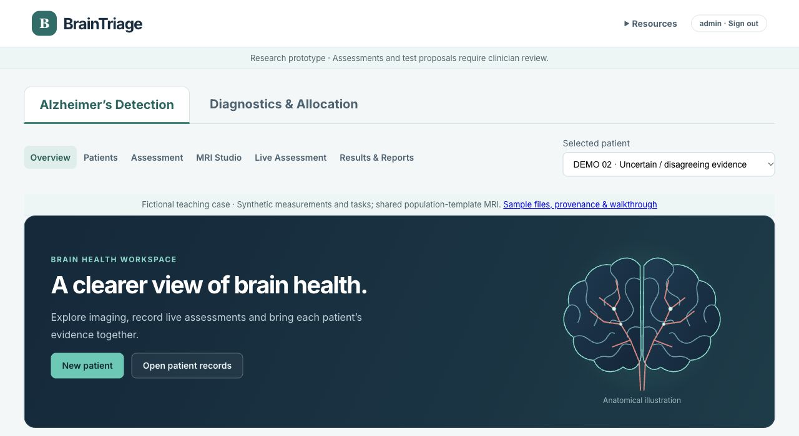
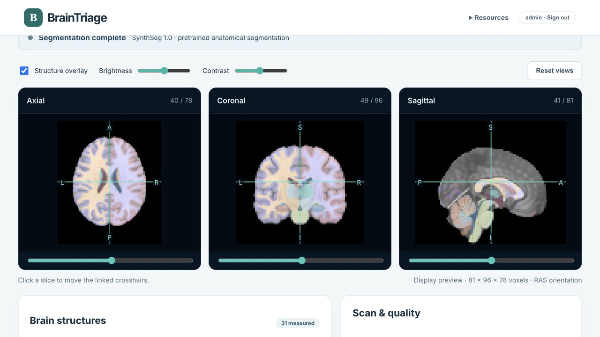
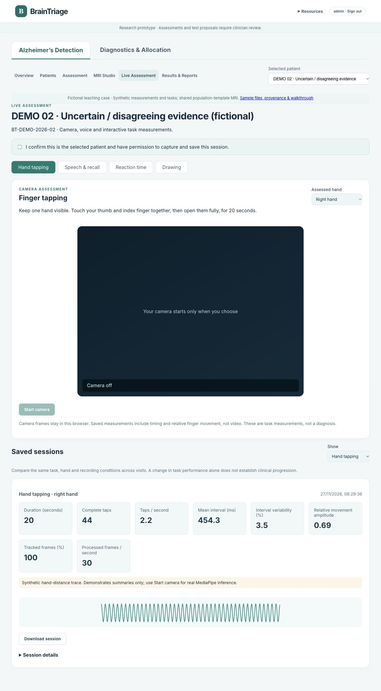
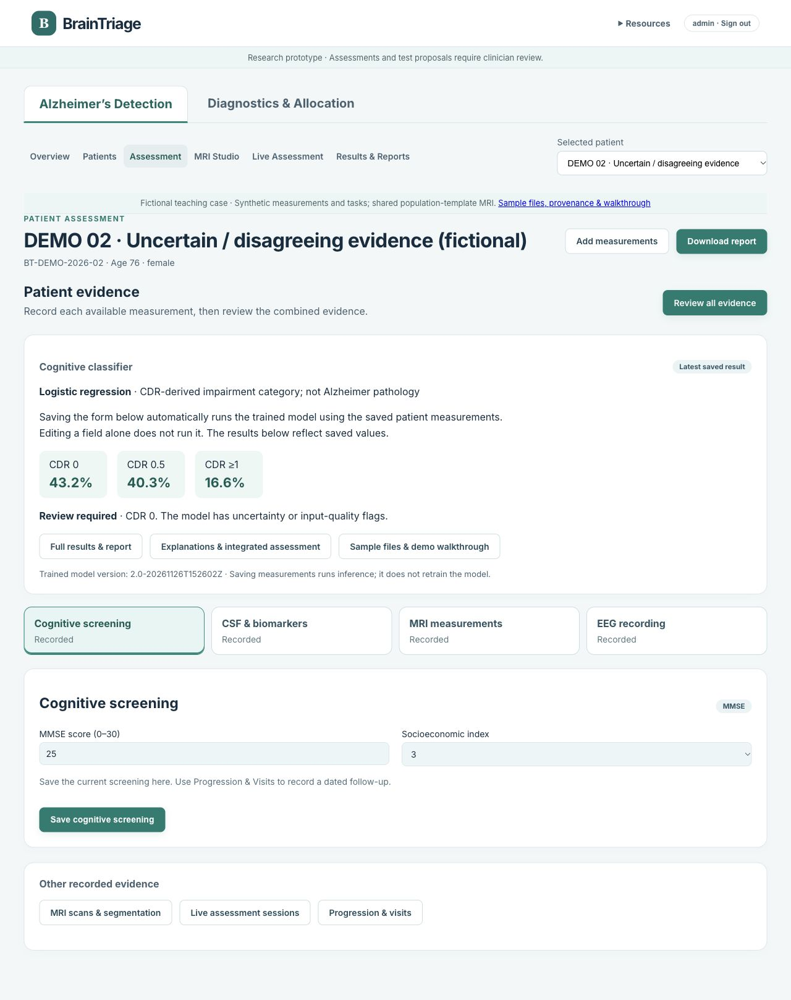
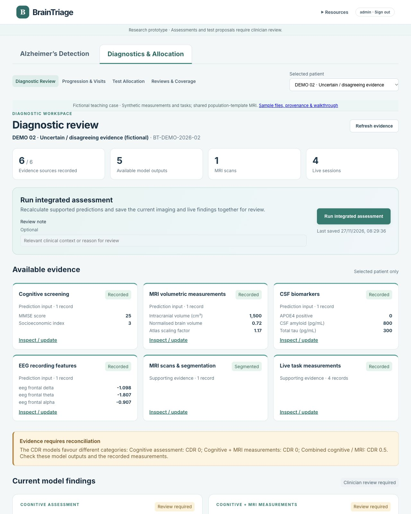
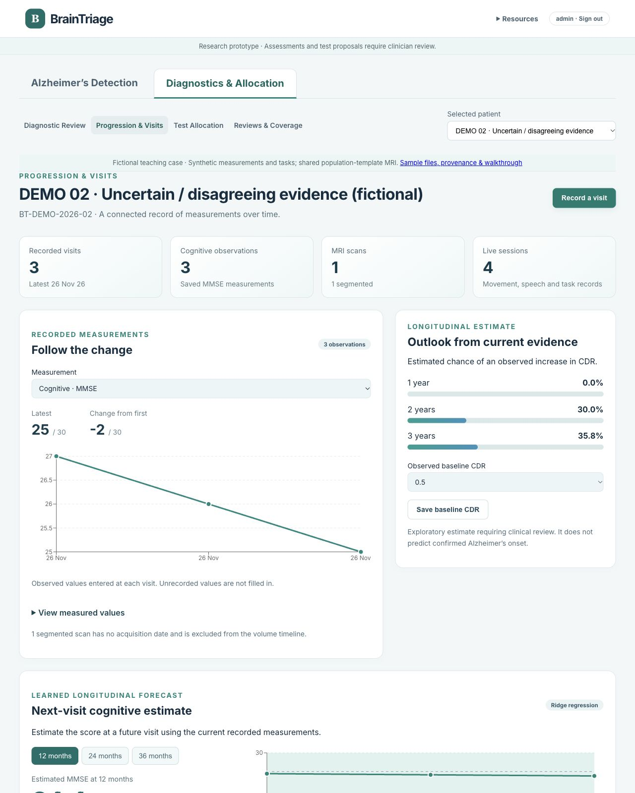
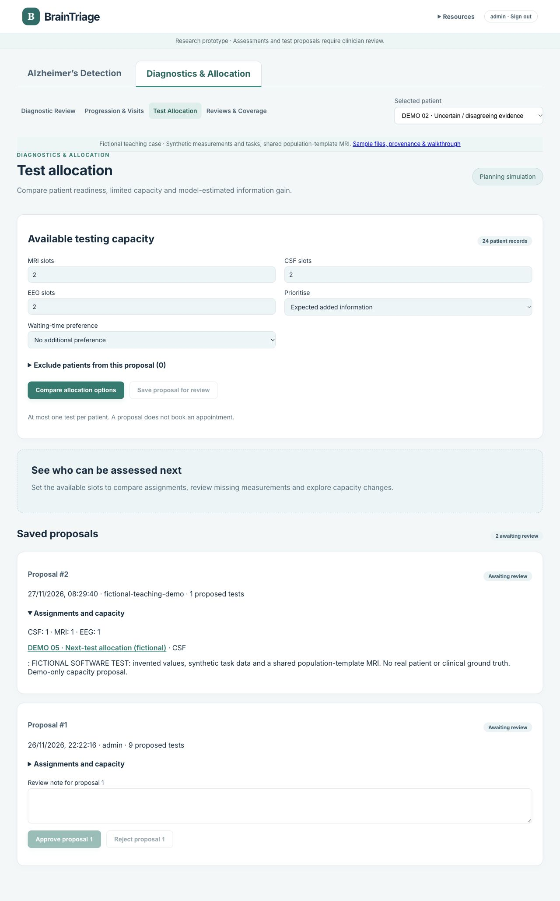

## BrainTriage project

## Project report and model metrics

- [Detailed project report (PDF)](docs/report/BrainTriage_Report.pdf)
- [Editable project report (Word)](docs/report/BrainTriage_Report.docx)
- [Complete model metrics and evaluation limits](docs/report/MODEL_METRICS.md)
- [Aggregate metrics snapshot (JSON)](docs/report/model_metrics.json)

The report includes accuracy, macro F1, AUROC, Brier loss, prediction-set coverage, error counts, candidate-selection scores, acquisition MSE/RMSE, survival concordance and MMSE forecast errors. Pretrained tools without a local accuracy benchmark are identified explicitly. Results are exploratory development estimates, not external clinical validation.

## Screenshots

Captured from the local teaching build on 27 November 2026. The displayed patient measurements are fictional. MRI Studio shows the shared MNI152 population template; these images demonstrate the interface and do not validate clinical performance. The report identifies the installed model versions and local implementation scope.

### Brain health overview

The landing screen introduces the patient workspace with an anatomical brain illustration.



### MRI Studio

Linked axial, coronal and sagittal views with SynthSeg 1.0 anatomical overlays.



### Live hand-camera assessment

Camera controls and saved finger-tapping measurements, including tap rate, timing variability, relative movement and tracking quality. The camera is off in this screenshot; the saved trace is a labelled synthetic teaching example, not a recorded MediaPipe session.



<details>
<summary>Assessment and saved model probabilities</summary>

Saving measurements runs the eligible fitted model. The screen identifies the estimator, saved probabilities and review status.



</details>

<details>
<summary>Diagnostic review and evidence coverage</summary>

Cognitive, measured MRI, CSF and EEG evidence appear beside image and live-task records, with disagreement flagged for review.



</details>

<details>
<summary>Progression and recorded visits</summary>

Observed measurements remain distinct from exploratory progression and next-MMSE estimates.



</details>

<details>
<summary>Test allocation and saved proposals</summary>

Per-test capacities and prioritisation controls support reviewable planning simulations. The expanded saved proposal uses fictional teaching cases.



</details>


The report and screenshots document the expanded local teaching build. The application description and setup instructions below refer to the earlier implementation currently committed on `main`.

AI-driven prioritization for early Alzheimer's diagnostic pathways — built for
the **Precision Care Challenge 2026**.

Most AD-risk demos run every patient through every test. BrainTriage models
the actual clinical constraint: MRI and PET slots are scarce, so the system
only escalates a patient to the next, more expensive/invasive stage
(**Cognitive → Blood → MRI → PET**) when the cumulative risk evidence
justifies it. Everything else is routed to routine monitoring. The dashboard
reports how much diagnostic capacity that saves across the cohort.

**⚠️ Three of four stages train on real published data; PET alone is
synthetic — see [docs/DATA_NOTE.md](docs/DATA_NOTE.md) for the per-stage
breakdown before showing this to a clinical audience.**

## What's inside

- **Adaptive 4-stage pipeline** with per-stage stacked classifiers
  (RandomForest; each stage sees its own features + upstream risk scores).
- **Real data for 3 of 4 stages**: Cognitive and MRI train on 606 real
  OASIS subject-visits (CC0), Blood/CSF trains on a real 198-patient CSF
  biomarker cohort (Dakterzada et al. 2023). Grouped/stratified splits so no
  subject leaks between train and test. PET stays synthetic, conditioned on
  each real subject's actual diagnosis — see [docs/DATA_NOTE.md](docs/DATA_NOTE.md).
- **Exact SHAP explainability** per prediction — top contributing factors,
  direction of effect.
- **Cost-aware triage queue** — patients ranked by urgency, with an
  estimated-resource-saved metric vs. running everyone through the full
  pipeline.
- **Longitudinal trajectory view** — risk over repeated assessments.
- **One-click clinician PDF report** per patient.
- **Model Card** — accuracy/F1/ROC-AUC *and data source* per stage, surfaced
  both in the API (`GET /api/meta/model-card`) and the dashboard.
- **What-If Simulator** — drag a slider on any real recorded feature (MMSE,
  CSF tau, hippocampal volume, …) and watch the model's risk estimate update
  live, stateless, nothing saved (`POST /api/patients/{id}/simulate`).
- **Diagnostic Resource Optimizer** — tell it how many CSF/MRI/PET slots a
  clinic has this week and it ranks the patients actually awaiting that test
  by risk, scheduling the scarce slots to whoever benefits most
  (`GET /api/queue/optimize`, `/optimize` page).
- **Auto-generated plain-English risk narrative** per stage, built from the
  same SHAP contributions as the explainability chart.
- **3D neural-network brain visualization** (Three.js, procedural — no
  external assets) as the dashboard hero and sidebar accent.

## Architecture

```
backend/   FastAPI + SQLite (SQLModel) + scikit-learn + SHAP
frontend/  React (Vite) + Recharts
```

## Running locally

### 1. Backend (http://localhost:8000)

```bash
cd backend
python3 -m venv .venv && source .venv/bin/activate
pip install -r requirements.txt
python fetch_real_data.py   # pulls the CSF cohort anonymously, no Kaggle account needed; OASIS is already committed
python seed_demo.py            # optional: populate demo patients
uvicorn app.main:app --reload --port 8000
```

Models train automatically on first startup (a few seconds) if no trained
artifacts exist yet; API docs at http://localhost:8000/docs.

### 2. Frontend (http://localhost:5173)

```bash
cd frontend
npm install
npm run dev
```

Open http://localhost:5173.

### 3. Or run the whole thing as one Docker container

```bash
docker build -t braintriage .
docker run -p 8000:8000 braintriage
```

No environment variables required — the CSF dataset downloads anonymously
from its public Kaggle listing at container start. Open
http://localhost:8000 — the backend serves the built frontend directly.
See [docs/DEPLOY.md](docs/DEPLOY.md) for deploying this publicly (Render
and Railway both covered — `render.yaml` included).

## Repo layout

```
backend/app///
  data/                    real OASIS CSVs (CC0), committed, see docs/DATA_NOTE.md
  data_external/           real CSF biomarker CSV (CC BY-NC-ND), fetched not committed
  real_data.py             loads + cleans both real cohorts
  synthetic_data.py        synthetic PET features, conditioned on real diagnosis
  ml/features.py           per-stage feature schema, upstream-stacking, data source
  ml/train.py              trains + persists one classifier per stage
  ml/pipeline.py           adaptive inference: run only justified stages, fuse risk
  ml/explain.py            SHAP-based per-prediction explainability
  routers/                 patients, queue, meta, report (PDF) endpoints
frontend/src/
  pages/                   Dashboard, NewPatient, PatientDetail
  components/               pipeline visualization, explainability chart,
                             trajectory chart, stage intake forms, model card
docs/DATA_NOTE.md          data provenance & how to swap in real ADNI/OASIS access
```
